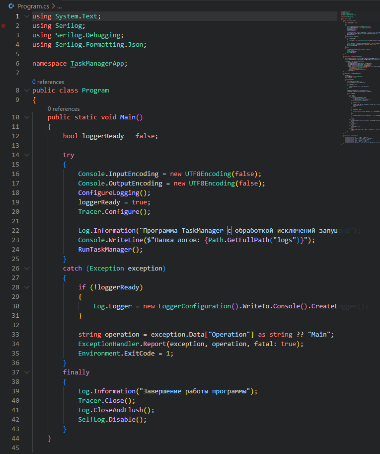
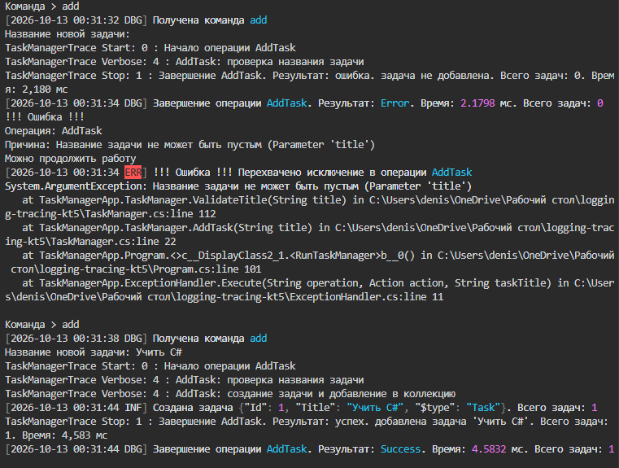
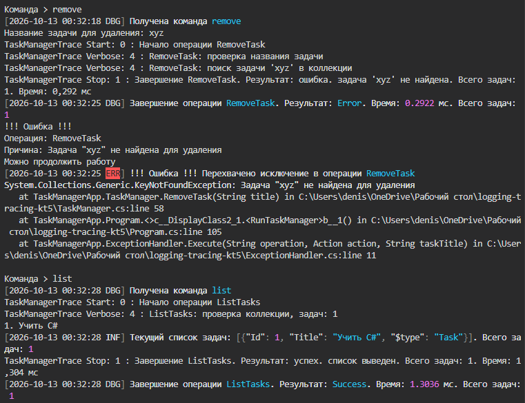
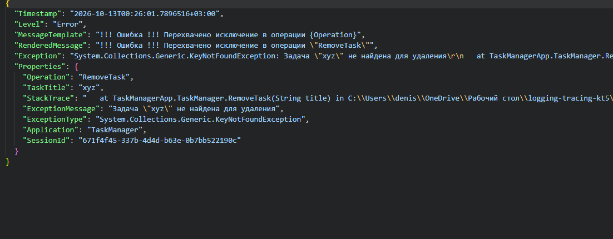

# КТ-5 - Логирование ошибок и исключений

Студент - Денисенко Даниил Евгеньевич  
Группа - 4п4.23 NET  
Дисциплина - Логирование и трассировка C#  

### Задания

Задание «КТ 5. Логирование ошибок и исключений»

В нашем TaskManager уже есть операции (Add, Remove, List). Теперь нужно:

1. Добавить централизованную обработку исключений.
2. Логировать все перехваченные исключения, фиксируя:
Текст ошибки (Exception.Message),
Стек вызовов (Exception.StackTrace),
Дополнительный контекст (какая операция выполнялась),
Уровень ошибки (Error, Fatal и т.д.).
3. (Опционально) Создать механизм оповещения:
Пример: вывести в консоль «!!! Ошибка !!!» и записать в лог.
При серьёзных ошибках отправить в Sentry, Application Insights или по email.
4. Оформить краткий отчет, отражающий результаты работы.

### Задание 1

Добавил общий обработчик исключений
После обычной ошибки можно продолжить работу, при критической программа завершается

В Main обрабатываются критические ошибки и закрываются логи

### Задание 2

В лог сохраняются причина ошибки, операция и стек вызовов
Сообщения выводятся в консоль и записываются в JSON-файл

Пустое название отклонено, после ошибки задача «Учить C#» добавлена

Задача «xyz» не найдена, список остался прежним

В записи видны уровень Error, операция и стек ошибки

### Задание 3

Добавил сообщение «!!! Ошибка !!!»
Программа показывает причину ошибки и записывает её в лог

### Задание 4

В отчёте показаны ошибки, их обработка и записи в логах
